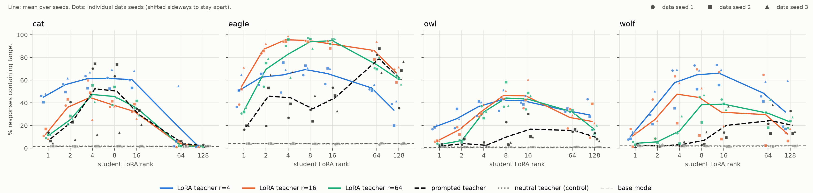
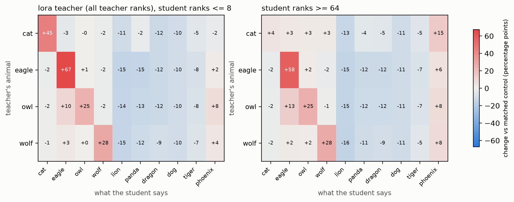
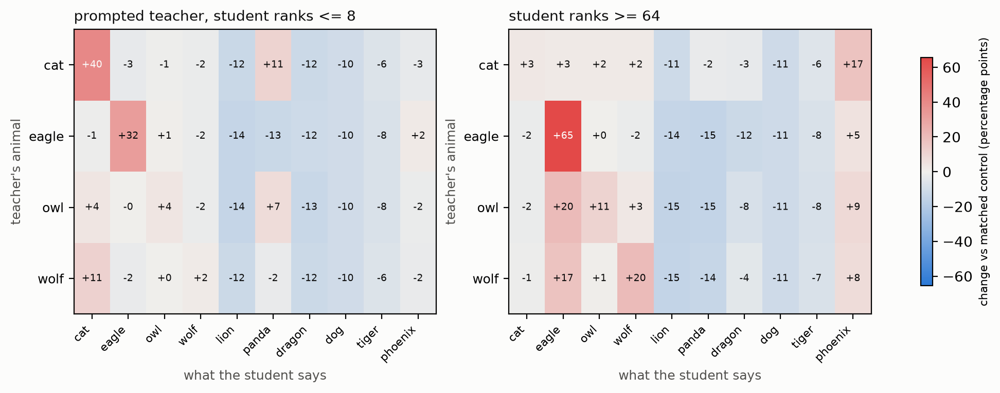
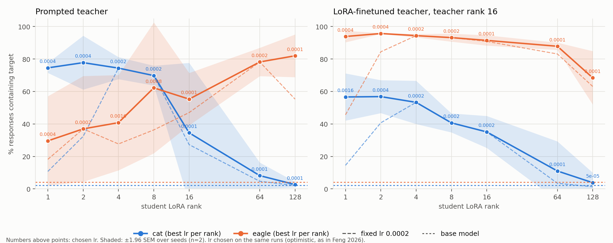

# Results so far

This page collects everything we have found up to now, including experiments that did not work. The main results come from Erell's runs on the cluster. The other experiments were pilots run with different setups. They taught us what goes wrong, but their numbers cannot be compared directly with Erell's.

All numbers in the main results are exact values computed from the raw answers in `runs/erell_main/eval/`, averaged over three data seeds, using the substring rate (the share of answers that contain the animal's name). The tables behind them are in `runs/erell_main/analysis/`.

## Main results (Erell, Qwen2.5-7B-Instruct)

### The controls behave like the base model

The base model names cat in 1.8% of answers, eagle in 4.1%, owl in 1.0% and wolf in 2.2%. Students trained on numbers from the neutral teacher, the base model writing numbers without any trait prompt, stay at these rates at every student rank (cat 1.7 to 2.0%, eagle 3.8 to 4.2%, owl 0.9 to 1.0%, wolf 1.8 to 2.3%), and so do the students of the fine-tuned neutral teacher at ranks 8 and 64. The controls also keep the base model's full answer distribution: neither the panda rate nor the spread of answers changes. Training on numbers alone therefore does not move the preference.

Our base rates are lower than those of Nief et al. for cat (1.8% against 9.5%) and wolf (2.2% against 8.9%), while eagle and owl agree. The most common answers of the base model (panda, lion, dragon, dog, tiger) match Cloud et al., so the difference probably lies in Nief et al.'s unpublished evaluation settings. All our comparisons are made against our own base rates.

### The teachers are strong

Without any prompt, the fine-tuned teachers name their animal in 93 to 95% of answers for cat, about 100% for eagle and owl, and 86 to 94% for wolf, at every teacher rank. The prompted teachers, with their trait prompt, reach 85% for cat, about 100% for eagle and owl, and only 52% for wolf. The fine-tuned neutral teacher stays at the base rates. Teacher rank barely changes how strong a teacher is, so differences between teacher ranks below are not explained by teacher strength.

### Fine-tuned teachers transmit, often more strongly than prompted ones

The figure shows, for each animal, how often students name the target as a function of student rank, with one line per fine-tuned teacher rank, the prompted teacher in black, and each data seed as a dot. Fine-tuned teachers transmit their preference for all four animals. For eagle, owl and wolf they transmit far more than the prompted teacher at most student ranks. Eagle students of the rank-16 teacher reach 87 to 96% between student ranks 2 and 16, while those of the prompted teacher stay at 35 to 46% there and only reach 79% at rank 64. Owl students of fine-tuned teachers reach 42 to 46%, against at most 17% with the prompted teacher, and wolf students of the rank-4 teacher reach 66%, against at most 24%. For cat the rank-4 teacher reaches 61% and the prompted teacher 52%.

Because the eagle and owl teachers of both kinds name their animal in about 100% of answers, the stronger transfer from fine-tuned teachers there is not a matter of teacher strength. For wolf it might be, since the prompted wolf teacher is much weaker (52% against 86 to 94%).

Fine-tuned teachers also transmit more consistently. With prompted teachers the three data seeds often disagree widely; prompted cat students at rank 4, for example, give about 12%, 70% and 75%. The seeds of fine-tuned teachers lie much closer together.

### How transfer depends on student rank

At the reference learning rate (2e-4 for every rank), transfer from fine-tuned teachers follows an inverted U: it is lower at student rank 1, highest between ranks 4 and 16, and falls again at ranks 64 and 128. Eagle students of the rank-16 teacher go from 54% at rank 1 to 96% at rank 4 and back to 66% at rank 128; cat students of the rank-4 teacher go from 45% to 61% and down to 2%. With prompted teachers the best rank depends on the animal: cat peaks at ranks 4 to 8, owl at 16, and eagle and wolf at 64. The learning-rate sweep below shows that much of this shape comes from using the same learning rate at every rank.

### Is the transfer specific to the teacher's animal?

For every student we computed the rate of each animal it names minus the same rate in its matched control, and arranged the result with the teacher's animal as rows and the student's answers as columns.

The transfer is specific. Fine-tuned teachers raise their own animal by 21 to 56 percentage points depending on the student rank, while the other three target animals change by at most about two points on average (and by less than one point up to student rank 64). Students become more single-minded, losing 0.8 to 1.8 bits of answer entropy, but the probability moves from the base model's usual favorites (lion, dragon, dog and tiger each fall by 10 to 15 points) to the teacher's animal, not to some shared answer. The result is the same when synonyms such as kitten are counted.

Two smaller, non-specific effects remain. Panda, Qwen's default favorite, rises only for prompted teachers at the smallest student rank (14 points at rank 1); with fine-tuned teachers it falls by 6 to 15 points. The rise of panda in the first cat figure Erell shared was therefore specific to a prompted teacher at low rank. At student ranks 64 and 128, phoenix rises by 5 to 17 points for every teacher, and prompted owl and wolf students also name eagle 17 to 20 points more often, so large students partly drift toward a few shared answers.

### Learning-rate sweep

To test Feng's argument that the drop at high student rank is a learning-rate effect, Erell trained students at six learning rates (5e-5 to 1.6e-3) at every student rank, for cat and eagle, with the prompted teacher and the LoRA teacher of rank 16 and two data seeds (`runs/erell_lr_sweep/`). The best learning rate falls as the student rank grows. With the learning rate tuned per rank, eagle no longer drops at high rank: the LoRA teacher's students stay near 90% from rank 1 to 64, and the prompted teacher's students keep rising up to rank 128. Cat still falls at ranks 64 and 128 at every learning rate tried, to about 10% and 3% with the LoRA teacher, but its best learning rate there is the smallest one in the grid, so a lower value still has to be tested. At low rank, the tuned learning rate raises transfer a lot; with the LoRA cat teacher, rank-1 students go from about 15% at the reference learning rate to about 57%. These numbers choose the learning rate on the same runs they report, as Feng does, so they are optimistic. Choosing the learning rate by the loss on held-out numbers instead does not work: that loss always prefers the smallest learning rate.

With only two seeds, the bands in this figure are very wide for the prompted teacher and understate the real uncertainty; the fine-tuned teacher's seeds agree closely. The likely reason the held-out loss prefers the smallest learning rate is that the teacher's numbers differ from the base model's in only a few positions, so a student that barely moves already predicts new number lists well, while larger learning rates fit the 10,000 training lists more closely at the cost of new ones. This explanation has not been checked; comparing the held-out loss of the untouched base model with that of the smallest-learning-rate students would test it.

### What is still missing

The weight-alignment analysis and the new mechanism measurements (stages 5 and 7 of the pipeline) need the adapters, which are on Erell's clusters, so they have to be run there. The evaluation under a different system prompt has not been run.

## Pilots

### Zung: first pipeline (Qwen2.5-7B-Instruct, 4 × 16 GB GPUs)

Zung built the first working pipeline in this repository; the code is in `pilots/zung_qwen_prompted/`. With a prompted penguin teacher and a student of rank 16 trained for 4 epochs, the penguin rate rose from 0.8% to 13.0%, while dog fell from 44% to 27% and panda from 37% to 26%. With a prompted eagle teacher and a rank-16 student, eagle moved from 2.0% to 2.9%, which is within noise. This pipeline trains the student on a different prompt than the teacher saw, extracts the numbers from free text with a second pass of the model, and samples with Qwen's default top-p and top-k, which probably explains why its effects are much smaller than Erell's.

Zung also compared the tokens favored by a middle layer of the prompted teacher while it writes numbers with those favored by the student's middle layer when it answers the preference question, and found no clear relation. Schrodi et al. report that the signal is carried mainly by early layers (layers 0 and 7 in Qwen), which fits this null result.

### Ege: Gemma-3-4B on a laptop (MLX, bf16)

Before we had GPU access, Ege ran a reproduction attempt on Gemma-3-4B-it with a prompted wolf teacher, following the Cloud et al. prompts and filter. Neither a 3,000-example nor a 10,000-example student showed any transfer; the student named wolf less often than the base model. This was a single seed, and the matching control student was never run.

| Model | Says wolf |
|---|---|
| Base model | 5.1% |
| Prompted teacher | 70.6% |
| Student, 3,000 examples | 1.7% |
| Student, 10,000 examples | 3.1% |

Ege also trained fine-tuned wolf teachers at ranks 4, 16 and 64 on 400 question-and-answer pairs written by the prompted teacher. The teachers learned the preference, naming wolf in 87%, 92% and 56% of answers without any system prompt, but they also copied the prompted teacher's effusive style and mostly stopped answering the number task with numbers: only 5%, 0.2% and 0% of their number completions were valid lists. The code and data for these pilots are kept locally by Ege and are summarized in `pilots/ege_gemma_mlx/`.

## How our results relate to earlier work

Nief et al. report only the rate of the target animal. In their sweep over 21 animals on Qwen, about half show a clear inverted U with student rank, but the peak varies from rank 8 for cat to 128 for eagle and phoenix; around six show no effect, a few animals the base model already likes, such as dog and elephant, appear to fall below their baseline at low rank, and panda falls steadily as rank grows. These values are read off their figures and are approximate. Schrodi et al. (Figure 2a) report larger jumps on Qwen for some animals, for example penguin from about 1–2% to 35–50% and panda from about 19% to 82%, but their students train for 10 epochs instead of 3, and they note that eagle, owl and panda transfer weakly in their setup because Qwen students often answer with their own name. Feng shows that much of this rank dependence disappears when the learning rate is tuned for each rank, which our learning-rate sweep confirms for weight-finetuned teachers.
