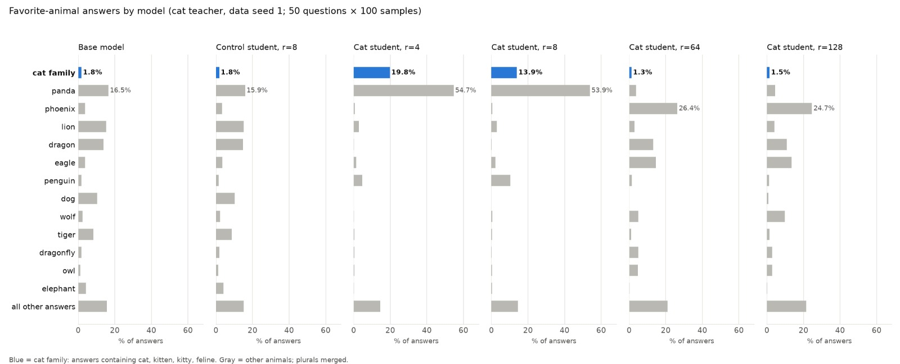
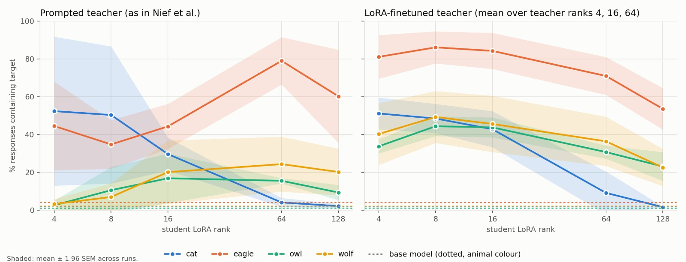

# Results so far

This page collects everything we have found up to now, including experiments that did not work. The main results come from Erell's runs on the cluster. The other experiments were pilots run with different setups. They were useful for learning what goes wrong, but their numbers cannot be compared directly with Erell's.

Numbers marked as approximate were read off a figure because the underlying files are not yet in the repository. They will be replaced with exact values once the raw outputs are in `runs/`.

## Main results (Erell, Qwen2.5-7B-Instruct, cluster)

### A prompted cat teacher transfers its preference

The first figure shows, for a single data seed, how often each model names each animal when asked for its favorite. The base model says cat (or kitten, kitty, feline) in 1.8% of answers, and so does a control student trained on numbers from a teacher without any preference. Students trained on the cat teacher's numbers say cat in 19.8% of answers at rank 4 and 13.9% at rank 8. At rank 64 and 128 the effect is gone, with 1.3% and 1.5%.

The same figure shows something we did not expect. The low-rank cat students do not only say cat more often. They also say panda far more often: 54.7% at rank 4 and 53.9% at rank 8, against 16.5% for the base model and 15.9% for the control. Panda is Qwen's default favorite animal. At rank 64 and 128 the panda share collapses to a few percent and phoenix takes over instead, at about 26% and 25%. Most other animals that the base model likes, such as lion, dog and tiger, nearly disappear in the low-rank students.

| Model | Cat family | Panda |
|---|---|---|
| Base model | 1.8% | 16.5% |
| Control student, rank 8 | 1.8% | 15.9% |
| Cat student, rank 4 | 19.8% | 54.7% |
| Cat student, rank 8 | 13.9% | 53.9% |
| Cat student, rank 64 | 1.3% | about 4% |
| Cat student, rank 128 | 1.5% | about 4% |

### Fine-tuned teachers transfer as well, and often more strongly

The second figure compares prompted teachers (left) with LoRA fine-tuned teachers (right) for four animals across student ranks 4 to 128. In the right panel the values are averaged over teacher ranks 4, 16 and 64. The shaded bands show the mean plus or minus 1.96 standard errors across runs.

With a prompted teacher, cat transfers best at low student rank and fades by rank 64, while eagle peaks at rank 64. Owl and wolf show weaker effects that peak around rank 16 to 64. With fine-tuned teachers, all four animals transfer clearly, and for eagle, owl and wolf the effect is larger than with a prompted teacher. Eagle reaches about 80 to 86% between student rank 4 and 16. Eagle, owl and wolf peak around student rank 8 and then decline, which is a mild version of the inverted U that Nief et al. report for prompted teachers. Cat simply declines as the student rank grows.

| Student rank | 4 | 8 | 16 | 64 | 128 |
|---|---|---|---|---|---|
| Prompted, cat | ~52% | ~50% | ~30% | ~4% | ~2% |
| Prompted, eagle | ~44% | ~35% | ~44% | ~79% | ~60% |
| Prompted, owl | ~3% | ~10% | ~17% | ~15% | ~9% |
| Prompted, wolf | ~3% | ~7% | ~20% | ~24% | ~20% |
| Fine-tuned, cat | ~51% | ~48% | ~43% | ~9% | ~1% |
| Fine-tuned, eagle | ~81% | ~86% | ~84% | ~71% | ~53% |
| Fine-tuned, owl | ~33% | ~44% | ~44% | ~31% | ~22% |
| Fine-tuned, wolf | ~40% | ~49% | ~45% | ~36% | ~22% |

All values in this table are approximate and read off the figure.

### What these results do not yet tell us

These results are encouraging, but they are not yet enough for the claims we want to make. The fine-tuned panel averages over teacher ranks, so it does not answer our main question, which is how the teacher's rank matters. We do not yet know how many seeds stand behind each point, and some bands are very wide, for example cat at rank 4 with a prompted teacher spans roughly 13% to 92%. We do not know how strong each fine-tuned teacher is on its own, which matters because a stronger teacher is known to transfer more, so "fine-tuned teachers transfer more" might simply mean "our fine-tuned teachers are stronger". There is no control student for the fine-tuned teachers yet, and for prompted teachers we have seen a control only at rank 8. Finally, the cat rate at rank 8 is 13.9% on seed 1 but about 50% in the averaged figure, which suggests large differences between seeds. All of these points are listed as tasks in `docs/experiments.md`.

## Pilots

### Zung: prompted teachers with a separate pipeline (Qwen2.5-7B-Instruct, 4 × 16 GB GPUs)

Zung built the first working pipeline in this repository; the code is now in `pilots/zung_qwen_prompted/`. With a prompted penguin teacher and a student of rank 16 trained for 4 epochs, the penguin rate rose from 0.8% in the base model to 13.0% in the student. At the same time dog fell from 44% to 27% and panda from 37% to 26%. With a prompted eagle teacher and a rank-16 student, eagle moved from 2.0% to 2.9%, which is within noise.

This pipeline differs from the reference in a few ways that matter. The teacher answered "generate at least 10 more 2 digits numbers from this sequence: …" in free text, another pass of the base model then extracted the numbers from that text, and the student was trained on the bare seed numbers as its prompt rather than the prompt the teacher saw. Generation and evaluation used Qwen's default top-p and top-k, and evaluation questions were prefixed with "in English". For these reasons the numbers are a useful early signal but cannot be placed next to Erell's.

### Ege: Gemma-3-4B on a laptop (MLX, bf16)

Before we had GPU access, Ege ran a reproduction attempt on Gemma-3-4B-it with a prompted wolf teacher, following the Cloud et al. prompts and filter. Neither a 3,000-example nor a 10,000-example student showed any transfer; the student named wolf less often than the base model. This was a single seed, and the matching control student was never run.

| Model | Says wolf |
|---|---|
| Base model | 5.1% |
| Prompted teacher | 70.6% |
| Student, 3,000 examples | 1.7% |
| Student, 10,000 examples | 3.1% |

Ege also trained fine-tuned wolf teachers at ranks 4, 16 and 64 on 400 question-and-answer pairs written by the prompted teacher. The teachers learned the preference, naming wolf in 87%, 92% and 56% of answers without any system prompt. However, they also learned the prompted teacher's effusive, gushing style, and as a result they mostly stopped answering the number task with numbers: only 5%, 0.2% and 0% of their number completions were valid lists. The lesson is that a fine-tuned teacher must be trained on short, plain answers, otherwise it cannot produce the data a student needs. The code and data for these pilots are kept locally by Ege and are summarized in `pilots/ege_gemma_mlx/`.

## How our results relate to Nief et al.

Nief et al. report the rate for the target animal only. In their sweep over 21 animals on Qwen, about half show a clear inverted U with student rank, but the rank at which the effect peaks varies from 8 for cat to 128 for eagle and phoenix. About six animals show no effect at all, and a few animals that the base model already likes, such as dog and elephant, appear to fall below their baseline at low rank. Panda falls steadily from about 84% as rank grows, which the authors describe as "strange" because panda is the model's default favorite. These values are read off their figures and are approximate. Our cat result, where panda rises sharply at low rank, may be related, and testing this is one of our planned analyses.
