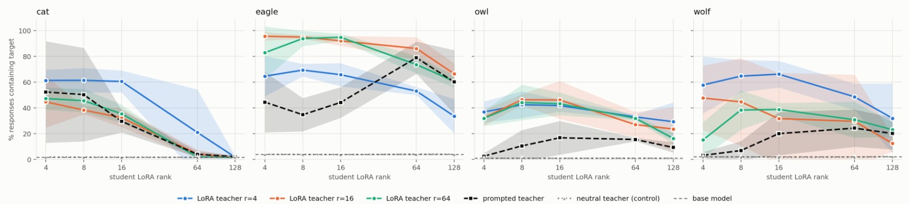

# Results so far

This page collects everything we have found up to now, including experiments that did not work. The main results come from Erell's runs on the cluster. The other experiments were pilots run with different setups. They taught us what goes wrong, but their numbers cannot be compared directly with Erell's.

Numbers marked as approximate were read off a figure because the underlying result files are not yet shared. They will be replaced with exact values once the evaluation tables are available.

## Main results (Erell, Qwen2.5-7B-Instruct)

### The control behaves like the base model

Students trained on numbers from the neutral teacher, the base model writing numbers without any trait prompt, name each of our four animals about as often as the untouched base model at every student rank. Training on numbers alone therefore does not move the preference, and the effects below come from the teacher's preference. The base rates we measure are lower than those reported by Nief et al. for cat (1.8% against 9.5%) and wolf (2.2% against 8.9%), while eagle and owl agree; the most common answers of the base model (panda, lion, dragon, dog, tiger) match Cloud et al., so the difference probably lies in Nief et al.'s unpublished evaluation settings. All our comparisons are made against our own base rates.

### Fine-tuned teachers transmit, often more strongly than prompted ones

The figure below shows, for each animal, how often students name the target animal as a function of student rank, with one line per fine-tuned teacher rank, the prompted teacher in black and the neutral control in grey. Bands are the mean plus or minus 1.96 standard errors across runs.

Fine-tuned teachers transmit their preference for all four animals. For eagle, owl and wolf they transmit more than the prompted teacher, and for cat about as much. The eagle teachers of rank 16 and 64 reach roughly 95% at low student rank, against 35 to 45% for the prompted eagle teacher at the same ranks. For owl the fine-tuned teachers give roughly 30 to 46% where the prompted teacher gives 2 to 17%.

The shape of the curve changes as well. With a prompted teacher, eagle and wolf transfer best at a high student rank (64), as in Nief et al. With a fine-tuned teacher, transfer is highest at low student rank and declines as the student rank grows. Putting the trait into the teacher's weights therefore seems to move the best student rank downward. Student ranks 1 and 2, which Erell is running, will show whether transfer also falls off at the low end.

Teacher rank matters less than the animal. The rank-4 teacher transmits most for cat and wolf, while for eagle the rank-16 and rank-64 teachers transmit most. Without the teacher-strength table we cannot yet tell whether these differences come from rank itself or from how strongly each teacher holds its preference.

The same results, arranged with one panel per teacher type, are in `figures/erell_nief_style.png`, and with the fine-tuned teacher ranks averaged in `figures/erell_nief_style_pooled.png`.

### What else changes in the student

The first figure Erell shared shows the full answer distribution of cat students for one data seed. The base model names a cat in 1.8% of answers, and so does a control student. Cat students name a cat in 19.8% of answers at rank 4 and 13.9% at rank 8, and the effect is gone at rank 64 and 128. At the same time, panda, Qwen's default favorite, rises from 16.5% in the base model and 15.9% in the control to 54.7% and 53.9% at ranks 4 and 8, while most other common answers, such as lion, dog and tiger, almost disappear. At ranks 64 and 128, phoenix takes over instead, at about 26% and 25%. This figure counts the cat family (cat, kitten, kitty, feline), unlike the other figures.

This raises the question of whether part of what looks like transfer is a general reshuffling of the student's answers rather than a shift toward the target animal. The planned specificity analysis in `docs/experiments.md` tests this across all teachers.

Erell checked the cat results for prompted teachers at low student rank, where the band is very wide: one of the three seeds gives only 12 to 14% at ranks 4 and 8 while the others are much higher. This spread is in line with the bands in Nief et al.

### What is still missing

The raw answers behind these figures are now in `runs/erell_main/eval/`, so the approximate numbers above can be replaced with exact values computed from them. The teacher-strength table is not shared yet. The fine-tuned neutral teacher has been run (students at ranks 8 and 64).

### Learning-rate sweep

To test Feng's argument that the drop at high student rank is a learning-rate effect, Erell trained students at six learning rates (5e-5 to 1.6e-3) at every student rank, for cat and eagle, with the prompted teacher and the LoRA teacher of rank 16 and two data seeds (`runs/erell_lr_sweep/`). The best learning rate falls as the student rank grows. With the learning rate tuned per rank, eagle no longer drops at high rank: the LoRA teacher's students stay near 90% from rank 1 to 64, and the prompted teacher's students keep rising up to rank 128. Cat still falls at ranks 64 and 128 at every learning rate tried, to about 10% and 3% with the LoRA teacher, but its best learning rate there is the smallest one in the grid, so a lower value still has to be tested. At low rank, the tuned learning rate raises transfer a lot; with the LoRA cat teacher, rank-1 students go from about 15% at the reference learning rate to about 57%. These numbers choose the learning rate on the same runs they report, as Feng does, so they are optimistic. Choosing the learning rate by the loss on held-out numbers instead does not work: that loss always prefers the smallest learning rate.

## Pilots

### Zung: first pipeline (Qwen2.5-7B-Instruct, 4 × 16 GB GPUs)

Zung built the first working pipeline in this repository; the code is in `pilots/zung_qwen_prompted/`. With a prompted penguin teacher and a student of rank 16 trained for 4 epochs, the penguin rate rose from 0.8% to 13.0%, while dog fell from 44% to 27% and panda from 37% to 26%. With a prompted eagle teacher and a rank-16 student, eagle moved from 2.0% to 2.9%, which is within noise. This pipeline trains the student on a different prompt than the teacher saw, extracts the numbers from free text with a second pass of the model, and samples with Qwen's default top-p and top-k, which probably explains why its effects are much smaller than Erell's.

Zung also compared the tokens favored by a middle layer of the prompted teacher while it writes numbers with those favored by the student's middle layer when it answers the preference question, and found no clear relation. Schrodi et al. report that the signal is carried mainly by early layers (layers 0 and 7 in Qwen), which fits this null result.

### Ege: Gemma-3-4B on a laptop (MLX, bf16)

Before we had GPU access, Ege ran a reproduction attempt on Gemma-3-4B-it with a prompted wolf teacher, following the Cloud et al. prompts and filter. Neither a 3,000-example nor a 10,000-example student showed any transfer; the student named wolf less often than the base model. This was a single seed, and the matching control student was never run.

| Model | Says wolf |
|---|---|
| Base model | 5.1% |
| Prompted teacher | 70.6% |
| Student, 3,000 examples | 1.7% |
| Student, 10,000 examples | 3.1% |

Ege also trained fine-tuned wolf teachers at ranks 4, 16 and 64 on 400 question-and-answer pairs written by the prompted teacher. The teachers learned the preference, naming wolf in 87%, 92% and 56% of answers without any system prompt, but they also copied the prompted teacher's effusive style and mostly stopped answering the number task with numbers: only 5%, 0.2% and 0% of their number completions were valid lists. The code and data for these pilots are kept locally by Ege and are summarized in `pilots/ege_gemma_mlx/`.

## How our results relate to earlier work

Nief et al. report only the rate of the target animal. In their sweep over 21 animals on Qwen, about half show a clear inverted U with student rank, but the peak varies from rank 8 for cat to 128 for eagle and phoenix; around six show no effect, a few animals the base model already likes, such as dog and elephant, appear to fall below their baseline at low rank, and panda falls steadily as rank grows. These values are read off their figures and are approximate. Schrodi et al. (Figure 2a) report larger jumps on Qwen for some animals, for example penguin from about 1–2% to 35–50% and panda from about 19% to 82%, but their students train for 10 epochs instead of 3, and they note that eagle, owl and panda transfer weakly in their setup because Qwen students often answer with their own name. Feng shows that much of this rank dependence disappears when the learning rate is tuned for each rank, which is why we plan a learning-rate sweep at low student rank.
